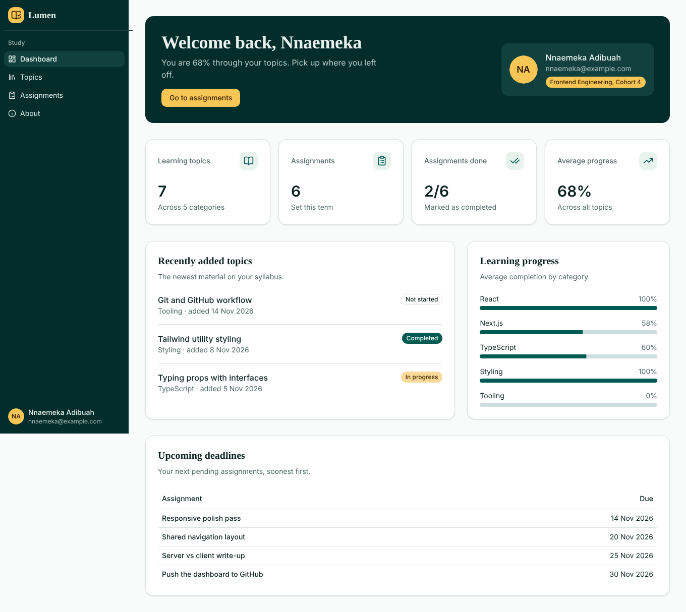
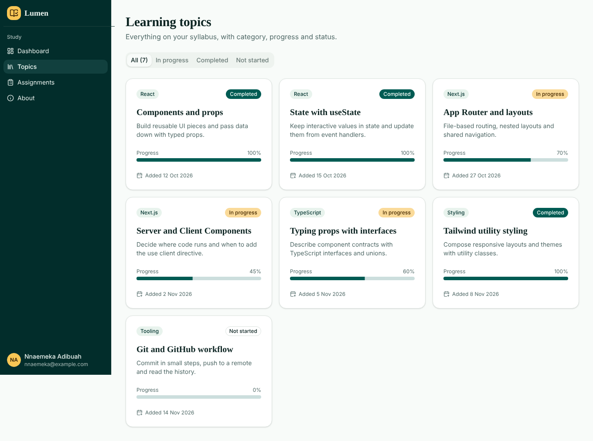
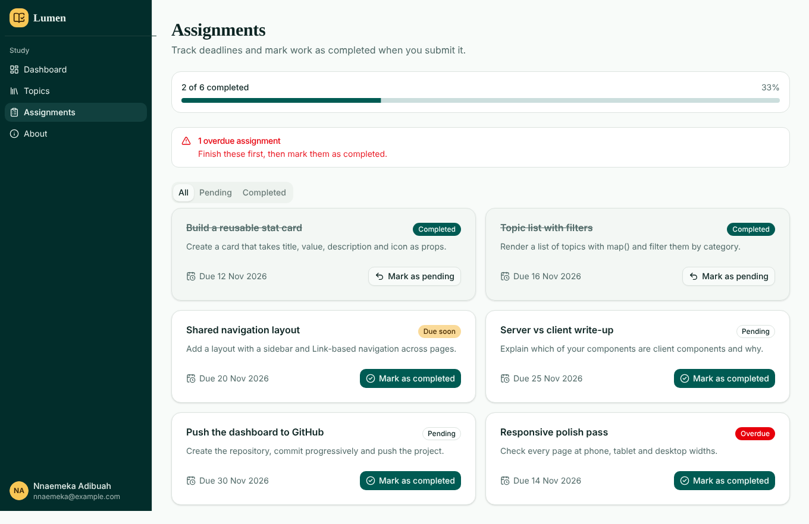
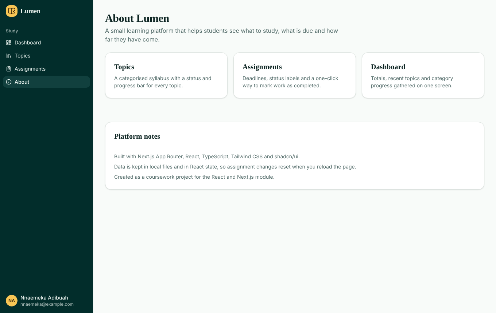

# Lumen: Student Learning Dashboard

A student learning dashboard built with **Next.js (App Router)**, **React**, **TypeScript**, **Tailwind CSS** and **shadcn/ui**. Students can see their learning topics, track progress and manage assignments.

## Pages

| Route | What it shows |
| --- | --- |
| `/` | Welcome banner, student info, stat cards, recently added topics, progress by category, upcoming deadlines |
| `/topics` | Seven topics with title, description, category, status and progress, filterable by status |
| `/assignments` | Six assignments with due dates, status labels and a button to mark each as completed |
| `/about` | Purpose of the platform and technology notes |

## Screenshots

| Dashboard | Topics |
| --- | --- |
|  |  |

| Assignments | About |
| --- | --- |
|  |  |

## Technologies

Next.js 16 (App Router), React 19, TypeScript, Tailwind CSS 4, shadcn/ui (Radix UI), lucide-react.

## shadcn/ui components used

Sidebar, Card, Button, Badge, Avatar, Progress, Tabs, Table, Separator, Alert, Skeleton, Dropdown Menu, Tooltip, Sheet, Input, Label.

## React and Next.js concepts demonstrated

- Reusable components with typed props: `StatCard`, `TopicCard`, `AssignmentCard` (takes an `onToggle` callback), `NavItem`, `PageHeader`, `TopicStatusBadge`.
- `useState` for the topic filter and the assignment completed state, plus event handlers.
- Conditional rendering (status badges, overdue alert, empty states) and `map()` with stable keys.
- App Router file-based routing, a shared root layout with the sidebar, and `Link` navigation.
- Server Components for pages and data; Client Components (`"use client"`) only where state or hooks are needed.
- A `loading.tsx` with Skeleton placeholders.

## Getting started

```bash
git clone https://github.com/<your-username>/student-learning-dashboard.git
cd student-learning-dashboard
npm install
npm run dev
```

Open http://localhost:3000. Use `npm run build` and `npm start` for a production build.

## Project structure

```
src/
  app/            routes: /, /topics, /assignments, /about
  components/     reusable components and components/ui (shadcn/ui)
  data/           sample student, topics and assignments
  lib/            cn() helper and date formatting
  types/          shared TypeScript interfaces
```

## Notes

Data is local sample data. Marking an assignment as completed lives in React state, so it resets on reload.
